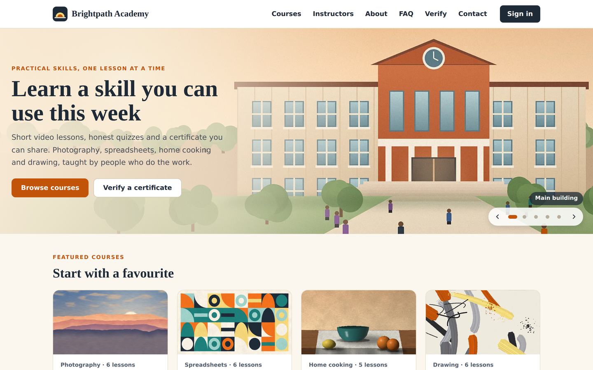
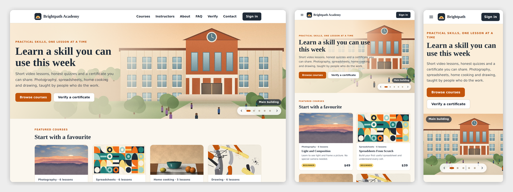

# Brightpath Academy — SkyNet Online School Template

A responsive online course school website template for **ASP.NET Core (.NET 10)**, built on the **SkyNet Framework**.

[](https://dotnet.microsoft.com/)
[](https://www.nuget.org/packages/TheSkyLite.SkyNet)



> **Sample content.** Brightpath Academy, its eight courses, four instructors, students, orders and prices are invented placeholders; replace them in the staff area (**Courses and lessons**, **Instructors**, **Pages**, **Settings**). Every form already saves for real: sign-ups, orders, progress, quiz results, certificates, refund requests and messages are written to JSON files in `data/`.

## Features

- **32 pages.** Public: Home, Courses (filter by topic and level), Course detail (syllabus, free preview lesson, price, refund policy), Instructors, About, FAQ, Terms and refunds, Contact, Certificate (check a certificate code). Student area: Sign in (two gateways: students sign in or create an account, staff and instructors go to staff sign-in), My courses, Lesson player, Quiz, Certificate, My account, Checkout. Staff area: sign-in, Dashboard, Courses and lessons, Quizzes, Students, Enrollments, Orders, Refunds, Instructors, Messages, Pages editor, Media library, Users and rights, Activity log, Settings, My account.
- **Responsive:** desktop, tablet and phone layouts; admin tables turn into cards on phones.
- **Home slideshow:** the page top shows pictures of the school (main building, classroom, teaching kitchen, studio, library) that change every 7 seconds, with dots, arrows and swipe. Staff add, remove and reorder the slides in the Pages editor. It stays still for visitors who ask their system for less motion.
- **Two sign-in gateways:** the header's Sign in page has one card for students (sign in or create an account with name, email, phone and password) and one for staff and instructors. Every public page also links to Staff sign in in the footer.
- **Student area:** sign up with name, email, phone and password, a password change in My account and an emailed reset link; progress per course, a lesson player with video from the Media library, notes and a next button, quizzes with a pass mark, a printable certificate with a verify code, and orders with receipts.
- **Card payments with Stripe Checkout.** A paid order opens the course. In Demo mode a test payment button replaces Stripe, so no keys are needed.
- **Refunds in full.** The conditions come from **Settings** (window in days, progress limit, no certificate issued). The student sees whether they qualify, with days left and progress, and gives a reason. Inside the conditions the request is marked eligible; outside it can still be sent and is marked outside policy. Staff check every request and approve in full (access ends, progress is kept but locked, the certificate is revoked), approve a partial goodwill amount (access stays) or decline with a reason the student sees. Never more than paid minus earlier refunds, and one open request per order. In Production the refund goes through the Stripe API and the refund id is saved; Demo simulates it. A refund made in the Stripe dashboard syncs back through the webhook. Receipts show the refund lines. A student can enroll again by paying again and keeps their progress.
- **Pages editor and Media library:** edit the text, buttons, pictures and order of every public page block by block, with the last five versions kept; upload and manage pictures and videos.
- **Staff accounts with rights:** several accounts, each with View, Edit and an Extra right per menu area. An instructor account sees only their own courses, quizzes, students and enrollments.
- **Activity log:** every change and every refused attempt, including each refund step.
- **Initialize data:** removes the sample and test records in one step, in Demo from **Settings**, and automatically once on the first Production start.
- **No front-end build:** plain HTML, CSS and vanilla JavaScript.



## Getting started

Requirements: .NET 10 SDK.

    git clone <your repo url>
    cd OnlineSchool
    dotnet run

The SkyNet package (`TheSkyLite.SkyNet`) restores from NuGet. The app opens on **Home**. The header's **Sign in** opens **/Join**, with one gateway for students and one for staff and instructors (**/AdminLogin**).

## Permissions

Each staff account gets a level per area. **Edit** needs **View**, and the **Extra** right needs **Edit**.

| Area | Rights | Extra right |
|---|---|---|
| Courses and lessons | View, Edit (can be limited to own courses) | Publish and delete |
| Quizzes | View, Edit (can be limited to own courses) | |
| Students | View, Edit (can be limited to own courses) | Reset password and switch off |
| Enrollments | View, Edit (can be limited to own courses) | Grant or end access |
| Orders | View, Edit | Cancel unpaid orders |
| Refunds | View, Edit (decide requests) | Reopen declined requests |
| Instructors | View, Edit | |
| Messages | View, Edit | Delete messages |
| Pages | View, Edit | Restore versions |
| Media library | View, Edit | Delete files |
| Activity log | View | |
| Users, Settings | managers only | |

A person without View on the Activity log still sees **My activity**, their own entries.

## Run mode

`appConfig/application.cfg` has `app.app.runmode`:

- **0 Demo** (as shipped): the staff sign-in is filled in (`demo` / `demo1234`) and any user name and password signs in as a demo manager with every right. A real account from the sample data signs in as that person. The student sign-in is filled in with the sample student `ava@example.com` / `demo1234`. Payment is a test button and refunds are simulated.
- **1 Production:** staff sign in with their own accounts, payments go through Stripe and refunds through the Stripe API. Set this before you go live.

## Stripe

Put your keys in `appConfig/application.cfg` (they ship as placeholders):

    app.stripe.secretkey | your-stripe-secret-key
    app.stripe.webhooksecret | your-stripe-webhook-secret

In the Stripe dashboard add a webhook endpoint at `https://<your site>/stripe/webhook` that sends `checkout.session.completed` and `charge.refunded`, and copy its signing secret into `app.stripe.webhooksecret`. **Settings** shows whether the keys are set and the exact webhook address. Demo mode needs no keys.

## Sample data

The site ships with invented records so the Demo looks like a working school: seven students (password `demo1234`: `ava@`, `ben@`, `chloe@`, `dev@`, `eli@`, `fay@`, `gus@example.com`), staff for each role (all with the password `demo1234`), orders, enrollments, quiz results, certificates, messages and an activity log around the day it was built.

| Sign in as | Role |
|---|---|
| `maya`, `luis` | Instructors; see only their own courses and students |
| `rosa` | Registrar: students and enrollments |
| `jamal` | Finance: orders and refunds |
| `nina` | Content editor: courses, pages, media |
| `omar` | Support: messages, read-only elsewhere |

The refund desk has one request of each kind: Ava's is eligible, Ben's is outside the policy, Chloe has a valid certificate (`BPA-7K3Q-92XD`), Dev was refunded in full and his certificate (`BPA-D4V2-8MQH`) is revoked, Eli got a partial refund, Fay was declined, and one refund was synced from the Stripe dashboard. The sample files are `data/*.json`; **Initialize data** removes the records and keeps courses, pages and media.

## Going live

1. Set `app.app.runmode | 1` in `appConfig/application.cfg` and add your Stripe keys.
   Fill in the `app.mail.*` lines too (server, port, address, user, password): the site uses them to email students a password-reset link from **Forgot your password?** on the sign-in page. Port 587 uses STARTTLS; port 25 sends in the clear. Until mail is set up, the page asks students to contact the school and staff reset the password from **Students**.
2. Start the site and open **/AdminLogin**. On this first start in Production the site removes every record made in Demo (sample and test students, enrollments, orders, refund requests, certificates, messages, the activity log, all staff accounts and sessions), keeps your courses, quizzes, settings, pages and media, writes `data/initialized.txt`, and creates a first password. This happens once; later starts and mode switches never remove anything.
3. Follow **First sign-in** below.

To wipe the data while still in Demo, a manager opens **Settings**, **Initialize data**, and types `INITIALIZE`.

## First sign-in (Production)

1. Run the site on your computer and open **/AdminLogin**. The page shows the first user name (`admin`) and a password made just for this site. It is shown only on the computer the site runs on, and is also in `appConfig/initial-admin.txt`.
2. Sign in and choose your own password. The box and the file disappear.
3. Open **Users and rights** and add an account for each person.

Forgot the first password before using it? Delete `appConfig/initial-admin.txt` and open the sign-in page again. Locked out of every manager account? Remove the managers from `data/staff.json` and open the sign-in page.

## Deploying

1. Publish with the `web.config` from the project (IIS). Give the application pool Modify on `data/`, `temp/`, `appConfig/` and `images/uploads/`. Use HTTPS.
2. If nobody has signed in yet, read the first password from `appConfig/initial-admin.txt` on the server.
3. Check that `/data/staff.json` and `/appConfig/initial-admin.txt` answer 404 in a browser.

> **Redeploying:** publishing copies `data/` over the live files. Download the live `data/` folder first or leave it out of the publish.

## Project structure

    appConfig/    application.cfg (run mode, Stripe keys)
    codes/        one class per page; Core/ holds Store, Access, Auth, Learn, Pay, Desk, Init, Media, Blocks
    codes/Models/ data classes
    htmls/        page markup with {plhd_*} placeholders
    scripts/      one IIFE namespace per page
    styles/       one stylesheet per page, every class prefixed
    data/         JSON files: site.json (content and settings) and the records
    images/       artwork, videos and uploads

### One page = four files, one name

| File | Holds |
|---|---|
| `codes/[Page].cs` | the page class and its server methods |
| `htmls/[Page].html` | markup with `{plhd_*}` placeholders |
| `scripts/[Page].js` | one IIFE namespace, `[Page]Js` |
| `styles/[Page].css` | styles, every class prefixed (`rf-` for AdminRefunds, `ac-` for Account, and so on) |

## SkyNet in action

The Refunds desk sends the decision with `$ApiRequest` and the server answers with what to show:

```js
api('Decide', [{ key: 'rid', vlu: id }, { key: 'kind', vlu: 'partial' }, { key: 'amount', vlu: val('rf-amt') }, { key: 'note', vlu: val('rf-note') }]);
```

```csharp
public async Task<ApiResponse> Decide()
{
    ApiResponse response = new ApiResponse();
    Ctx? c = await Ad.Guard(response, "AdminRefundsJs", GetDataValue("tok"));
    if (!Access.Can(c.U, "refunds", 'E')) { return await Ad.Refuse(...); }
    (bool ok, string message) = await Desk.Decide(c, id, kind, amount, note);
    response.ExecuteScript("AdminRefundsJs.decided(" + (ok ? "true" : "false") + ", '" + Ui.Js(message) + "');");
    return response;
}
```

| Page | Request | Response |
|---|---|---|
| Courses | `Filter` | the course cards for the chosen topic and level |
| Course | `Buy` | makes or reuses an unpaid order and opens Checkout |
| Checkout | `Start`, `DemoPay` | Stripe Checkout in Production, a test payment in Demo; the order is paid and the course opens |
| Lesson | `Complete` | marks the lesson done and shows the next step |
| Quiz | `Submit` | grades on the server, keeps the best score, issues the certificate |
| Account | `RequestRefund` | checks the conditions, marks the request eligible or outside policy |
| AdminRefunds | `Decide`, `Reopen` | refunds in full, partly or declines; ends access and revokes the certificate on a full refund |
| AdminOrders | `Simulate` | Demo only: sends the event Stripe sends for a dashboard refund |

## Customize it

- **Content:** courses, lessons, quizzes and instructors in the staff area, or `data/site.json`; public pages in **Pages**
- **Refund conditions and school details:** **Settings**
- **Brand name, colors, fonts:** the `--xx-` color and font variables at the top of each `styles/*.css`; the palette is ink `#1F2A37`, orange `#C2540A`, teal `#1E6F6A`, butter `#F6D77A`, with Fraunces and Inter

## License

- **This template:** MIT — free to use, modify and redistribute, including commercially.
- **SkyNet Framework** (`TheSkyLite.SkyNet` NuGet package): proprietary, free to use including commercial use; see the license included in the package.

Both parts are in the `LICENSE` file at the project root.
